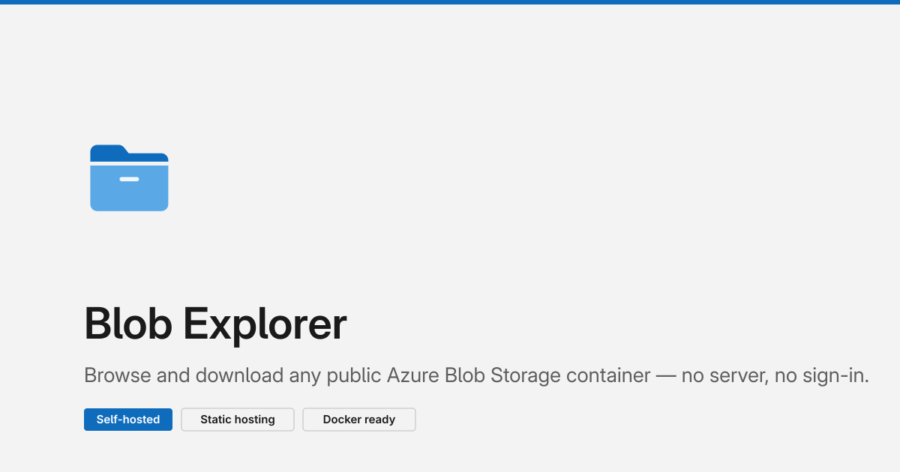

# Blob Explorer

<p align="center">
  
</p>

<p align="center">
  A self-hosted web interface for browsing and downloading files from any public Azure Blob Storage container.
</p>

<p align="center">
  <a href="https://github.com/joshooaj/blobexplorer/pkgs/container/blobexplorer"></a>
  <a href="https://hub.docker.com/r/joshooaj/blobexplorer"></a>
  <a href="LICENSE"></a>
</p>

## Demo

[blobexplorer.joshooaj.com](https://blobexplorer.joshooaj.com) browses a live Azure storage container.

To browse a different container, click "Open another container" at the top and enter its URL. You can find public containers with a search engine query like `inurl:"blob.core.windows.net/"`; a container only works if its owner enabled anonymous read access.

## What it does

- Folder tree navigation backed by O(1) lookups, built for containers with 100K+ files.
- One continuous scroll. Windowed rendering puts only visible rows in the DOM, so large containers scroll smoothly without pagination.
- Instant search with wildcards, regex, and fuzzy matching (`~text`).
- Pin folders, files, or searches as favorites.
- Filter by file type: installers, PDFs, ZIPs, and more.
- Explorer behavior: single-click selects, double-click downloads, sortable columns, a details pane, and list and tiles views. Folders show their recursive size and the modification date of their newest file. Size and date sorts keep folders and files in separate groups, like Windows 11.
- Light and dark themes follow the system, with a manual toggle.
- Works on mobile. Touch devices get single-tap open, always-visible actions, and file names wrapped onto two lines instead of revealed on hover.
- Keyboard navigation, screen reader support, and skip links.
- No external dependencies; all assets are self-hosted.
- The server caches the blob list and the browser caches it in IndexedDB, so repeat loads are instant.
- Bring your own analytics: the site fires custom DOM events your script can listen to.

## Getting started

### Pull the image

Create a `docker-compose.yaml`:

```yaml
services:
  blob-explorer:
    image: joshooaj/blobexplorer:latest
    container_name: blob-explorer
    ports:
      - "8080:8080"
    volumes:
      - ./config:/config
      - blob-cache:/cache
    environment:
      - BASE_URL=https://myaccount.blob.core.windows.net/mycontainer
    restart: unless-stopped

volumes:
  blob-cache:
```

```bash
docker compose up -d
```

### Build from source

```bash
git clone https://github.com/joshooaj/blobexplorer.git
cd blobexplorer
```

Set your `BASE_URL` in a `docker-compose.override.yaml`:

```yaml
services:
  blob-explorer:
    ports:
      - "8080:8080"
    environment:
      - BASE_URL=https://myaccount.blob.core.windows.net/mycontainer
```

```bash
docker compose up -d --build
```

Open <http://localhost:8080>.

## Configuration

### Environment variables

| Variable | Required | Default | Description |
|----------|----------|---------|-------------|
| `BASE_URL` | Yes | | Azure Blob Storage container URL |
| `DOWNLOAD_BASE` | No | Same as `BASE_URL` | Alternate download URL, e.g. a CDN or Front Door |
| `SITE_TITLE` | No | `Blob Explorer` | Title shown in the header and browser tab |
| `SITE_DESCRIPTION` | No | `Browse and download files...` | Meta description |
| `LOGO_URL` | No | Default logo | URL to a custom logo image |
| `LOGO_FILE` | No | | Path to a logo file relative to `/config`, e.g. `my-logo.svg` |
| `UPDATE_INTERVAL` | No | `86400` | Seconds between blob list refreshes |
| `ALLOW_CUSTOM_URL` | No | `false` | Let visitors browse other blob storage URLs from settings |
| `SHOW_FOLDERS_NAV` | No | `false` | Show the full folder tree in the navigation sidebar |
| `TZ` | No | `UTC` | Container timezone; affects only `docker logs` timestamps. The web UI always renders times in the visitor's browser timezone |

### Config file

On first run the container writes a default `config.json` to the `/config` volume. Edit it to set favorites, analytics, and the other site options. Environment variables override config file values. `config.schema.json` gives editors autocompletion and validation.

```json
{
  "$schema": "./config.schema.json",
  "siteTitle": "My Downloads",
  "siteDescription": "Browse and download files",
  "logoUrl": "",
  "showFoldersNav": false,
  "analyticsScript": "analytics.html",
  "favorites": [
    {
      "label": "Recent Releases",
      "type": "folder",
      "path": "releases/2024"
    },
    {
      "label": "Documentation",
      "type": "search",
      "query": "\\.pdf$"
    },
    {
      "label": "Latest Versions",
      "type": "pattern",
      "pattern": "^v\\d+\\.\\d+",
      "limit": 3,
      "sortOrder": "desc"
    }
  ]
}
```

Favorite types:

| Type | Description | Required fields |
|------|-------------|-----------------|
| `folder` | Navigate to a folder path | `path` |
| `search` | Run a regex search query | `query` |
| `pattern` | Auto-match folders by regex | `pattern`, optional `limit` and `sortOrder` |

### Reverse proxy (Traefik)

```yaml
services:
  blob-explorer:
    # ... other config ...
    networks:
      - web
    labels:
      - "traefik.enable=true"
      - "traefik.http.routers.blob-explorer.entrypoints=https"
      - "traefik.http.routers.blob-explorer.rule=Host(`downloads.example.com`)"
      - "traefik.http.services.blob-explorer.loadbalancer.server.port=8080"

networks:
  web:
    external: true
```

## Keyboard shortcuts

| Key | Action |
|-----|--------|
| `↑` / `↓` or `j` / `k` | Move between items |
| `Enter` or `l` | Open the selected folder |
| `h` or `Backspace` | Go up one level |
| `PageUp` / `PageDown` | Scroll a page |
| `Home` / `End` | Jump to first / last item |
| `,` then `a` / `e` / `m` / `s` | Sort; uppercase reverses |
| `/` | Focus search; `Enter` commits and returns to the list |
| `Ctrl` + `C` | Copy the selected file's link |
| `Ctrl` + `P` | Pin the current view |
| `Ctrl` + `B` | Toggle the navigation pane |
| `Esc` | Clear the search or close a dialog |
| `?` | Open the help dialog |

## Analytics

Blob Explorer fires custom DOM events. Host a script in your config folder and listen to them.

### Setup

1. Create an analytics file in your config folder.
2. Point `analyticsScript` at it in `config.json`:

```json
{ "analyticsScript": "analytics.html" }
```

File formats:

- `.js`: plain JavaScript, wrapped in `<script>` tags
- `.html`: injected as-is, for loading external scripts via `<script src="...">`

### Events

| Event | Detail properties |
|-------|-------------------|
| `blob-explorer:page-view` | `path`, `url`, `timestamp` |
| `blob-explorer:search` | `query`, `resultCount`, `timestamp` |
| `blob-explorer:download` | `fileName`, `filePath`, `fileSize`, `fileType`, `timestamp` |
| `blob-explorer:copy-link` | `fileName`, `filePath`, `timestamp` |
| `blob-explorer:folder-navigate` | `folderPath`, `folderName`, `timestamp` |
| `blob-explorer:filter-change` | `activeFilters`, `totalFilters`, `timestamp` |
| `blob-explorer:theme-change` | `theme`, `timestamp` |
| `blob-explorer:favorite-add` / `favorite-remove` | `label`, `type`, `path`, `timestamp` |
| `blob-explorer:custom-url-load` | `host`, `container`, `blobCount`, `timestamp` |

<details>
<summary>Example: Google Analytics 4</summary>

Create `./config/analytics.html`:

```html
<script async src="https://www.googletagmanager.com/gtag/js?id=G-XXXXXXXXXX"></script>
<script>
  window.dataLayer = window.dataLayer || [];
  function gtag() { dataLayer.push(arguments); }
  gtag('js', new Date());
  gtag('config', 'G-XXXXXXXXXX');

  document.addEventListener('blob-explorer:download', (e) => {
    gtag('event', 'download', {
      file_name: e.detail.fileName,
      file_type: e.detail.fileType,
      file_size: e.detail.fileSize
    });
  });

  document.addEventListener('blob-explorer:search', (e) => {
    gtag('event', 'search', { search_term: e.detail.query });
  });
</script>
```

```json
{ "analyticsScript": "analytics.html" }
```

</details>

<details>
<summary>Example: Plausible</summary>

Create `./config/analytics.html`:

```html
<script async src="https://plausible.io/js/script.js"></script>
<script>
  window.plausible = window.plausible || function() { (plausible.q = plausible.q || []).push(arguments) };

  document.addEventListener('blob-explorer:download', (e) => {
    plausible('Download', { props: { file: e.detail.fileName, type: e.detail.fileType } });
  });

  document.addEventListener('blob-explorer:search', (e) => {
    plausible('Search', { props: { query: e.detail.query, results: String(e.detail.resultCount) } });
  });

  document.addEventListener('blob-explorer:folder-navigate', (e) => {
    const baseUrl = window.location.protocol + '//' + window.location.hostname;
    const segments = e.detail.folderPath.split('/').filter(Boolean).map(encodeURIComponent);
    const virtualPath = segments.length ? '/folder/' + segments.join('/') + '/' : '/';
    plausible('pageview', { u: baseUrl + virtualPath });
  });
</script>
```

```json
{ "analyticsScript": "analytics.html" }
```

</details>

<details>
<summary>Example: simple event logging</summary>

Create `./config/analytics.js`:

```javascript
document.addEventListener('blob-explorer:download', (e) => {
  console.log('Download:', e.detail.fileName, e.detail.fileSize);
});

document.addEventListener('blob-explorer:search', (e) => {
  console.log('Search:', e.detail.query, 'Results:', e.detail.resultCount);
});
```

Plain `.js` files are wrapped in `<script>` tags automatically.

</details>

## Architecture

Blob Explorer runs as a single Docker container:

1. nginx serves the static site on port 8080.
2. A background updater fetches the blob list from Azure Storage on the `UPDATE_INTERVAL` schedule.
3. The entrypoint generates runtime config from `config.json` and environment variables at startup.
4. Cached data in `/cache` lets the container start instantly after a restart.

### Volumes

| Mount point | Purpose |
|-------------|---------|
| `/config` | Configuration: `config.json`, logos, analytics scripts |
| `/cache` | Blob data cache for fast startup |

### Startup sequence

1. The entrypoint writes a default `/config/config.json` if one is missing.
2. It merges environment variables with config file values. Environment variables win.
3. The site serves cached blob data from `/cache` immediately and refreshes stale data in the background.
4. The browser caches data in IndexedDB for fast subsequent page loads.
5. The blob list refreshes on the `UPDATE_INTERVAL` schedule.

## Requirements

- A public Azure Blob Storage container with anonymous access set to "Container"
- Docker, podman, or any container runtime; the examples use docker compose

## License

MIT
